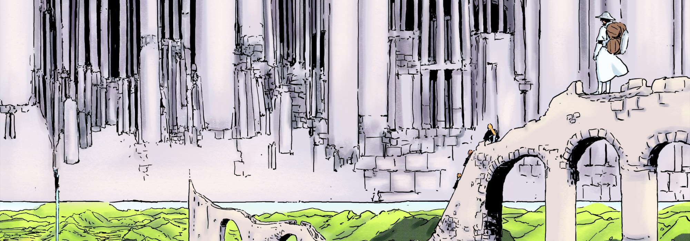
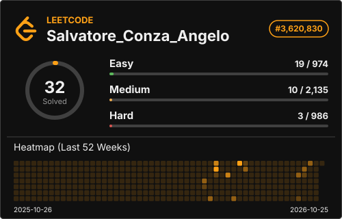
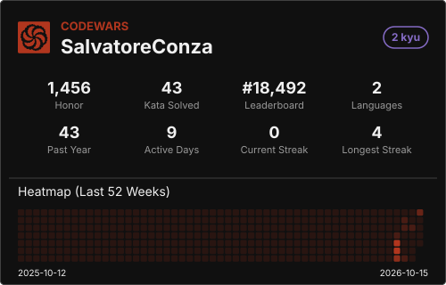
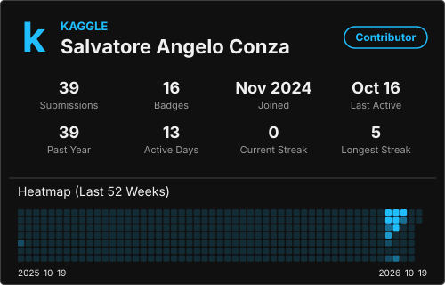
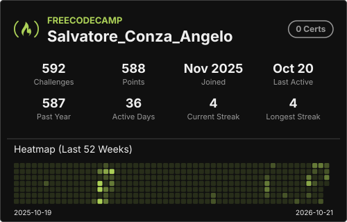
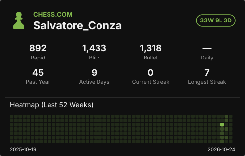
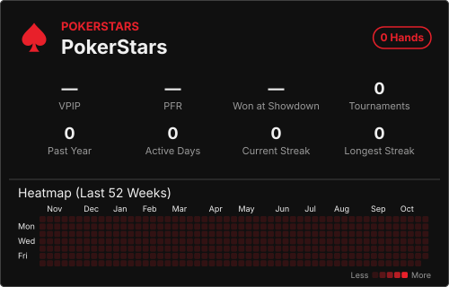

  

<h1 align="center">Hi 👋, I'm Salvatore, if you want you can call me Salva</h1>
<h3 align="center">Mathematics | Engineering | Complex Systems | ML and NNs </h3>

- 🔭 I'm currently working on **Wind Velocity Maps Predictions via Fourier Neural Operators** and **Graph Neural Operators** 💨🍃 
- ⏳ I have worked on [**Rat Pose Estimation and Detection via Convolutional Neural Networks**](https://github.com/SalvatoreConza/rat-pose-estimation-and-detections) 🐀🐁
- 🌱 I'm currently learning **Machine Learning** and **Deep Learning** by contibuiting to ML/DL repos like DeepChem, Visdom, Alaska Firebanks and ML4SCI.
- 🧩 I'm sharpening my data skills on **[Kaggle](https://www.kaggle.com/salvatoreangeloconza)** and my coding on **[LeetCode](https://leetcode.com/u/Salvatore_Conza_Angelo/)** and **[Codewars](https://www.codewars.com/users/SalvatoreConza)**. 
- 🎯 I'm currently trying to land an internship at **GSoC27**, **Vulcanus** or in a **ML Lab**.
- 🏭 On Industry side I was intern at **Fastweb** working on **network traffic simulations** 🌐 and now I am intern at **Leonardo** working on **numerical methods and simulation for plane wings and composite materials** ✈️
- 📫 How to reach me **s.conza@studenti.unina.it**
- 🃏 Curiosity about me: I was [top1000](https://www.reddit.com/r/MarvelSnap/comments/1mbeuna/making_infinite_top_1000_khonshu_discard/) infinite on Marvel Snap (top 0.1%-0.01% of the players). I also like **poker** ♠️ and **[chess](https://www.chess.com/member/salvatore_conza)** ♟️
- 🌍 I have worked and studied in Italy, Germany, Sweden and Spain.
- 💻 Confident on **Python** 🐍, **C++** ➕➕, **Bash** 🐚 and **SQL** 🗄️

  
  
  
  
  
  

